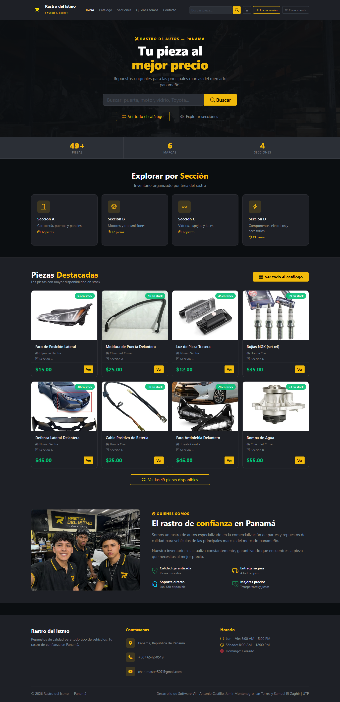
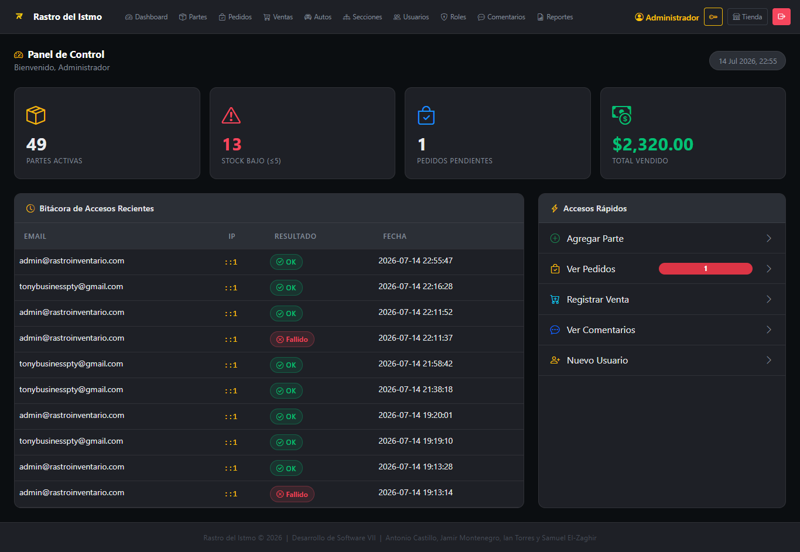
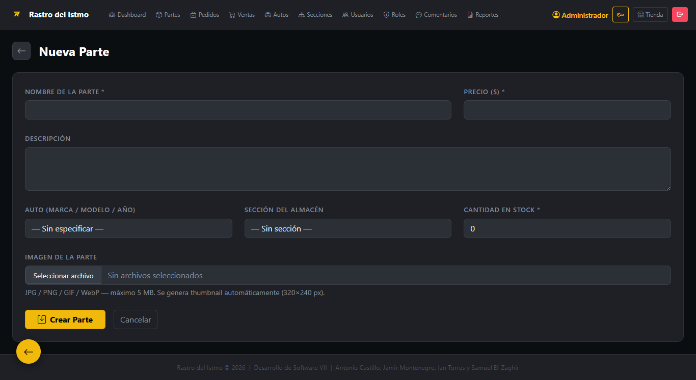
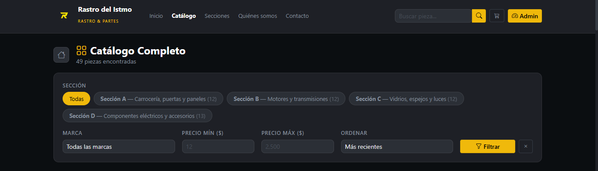
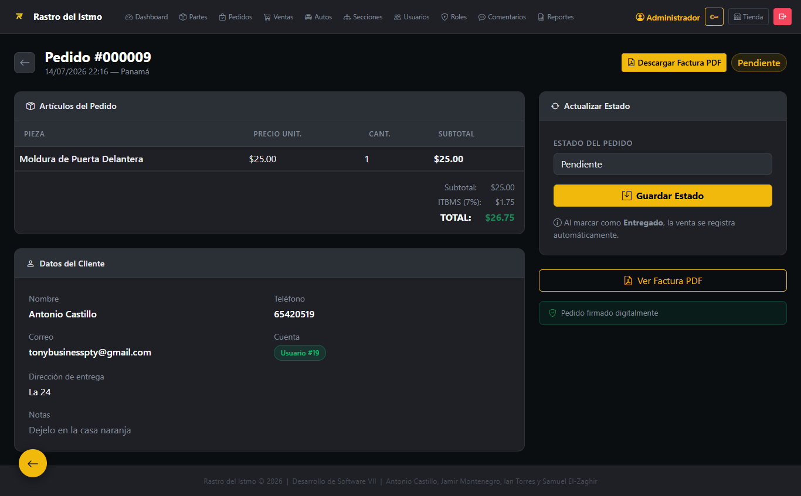
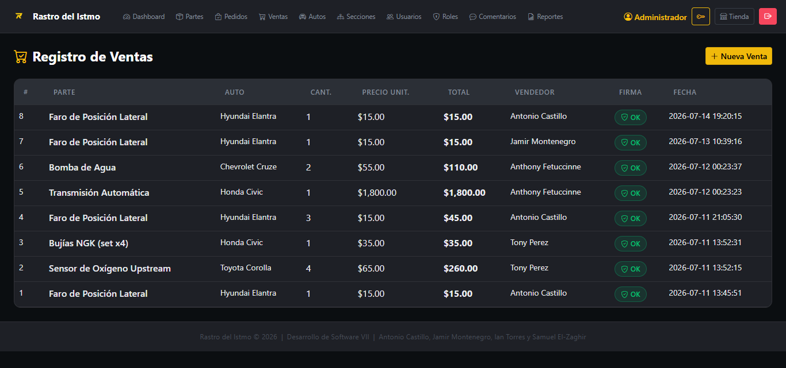
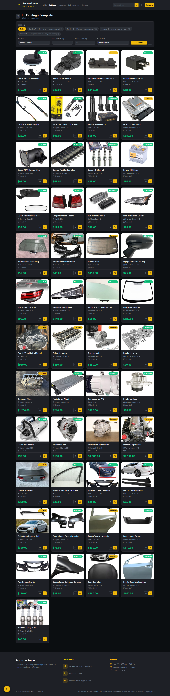

# Rastro del Istmo — Sistema de Inventario y Venta de Repuestos de Autos Usados

> Universidad Tecnológica de Panamá — Facultad de Ingeniería en Sistemas Computacionales
> Desarrollo de Software VII — Grupo 1GS131 — I Semestre 2026
> Proyecto asignado: *Sistema de Inventario o Rastro*

---

## 1. Información General y Evidencia Práctica

### 1.1. Nombre del Proyecto
**Rastro del Istmo** — Sistema de Inventario y Venta de Repuestos de Autos Usados.

### 1.2. Integrantes del Equipo

| Nombre | Cédula | Rol en el desarrollo |
|---|---|---|
| Antonio Castillo | 🔲 *8-1038-2499* | 🔲 *Líder de Proyecto — Arquitectura backend (MVC, modelos, controladores), seguridad (firmas digitales, CSRF, control de acceso) y base de datos. Frontend — Vistas, CSS y diseño de interfaz (panel admin + tienda pública)* |
| Ian Torres | 🔲 *20-53-8265* | 🔲 *Carga de Datos de Prueba — ayudar a poblar el inventario semilla (las partes de autos, imágenes de prueba)* |
| Jamir Montenegro | 🔲 *8-1017-1078* | 🔲 *Documentación — README, diagramas UML, manual de usuario* |
| Christian Dominguez | 🔲 *8-999-892* | 🔲 *Pruebas y QA — Casos de prueba, validación de formularios, revisión de bugs* |

### 1.3. Fecha del Sistema y Versión
- **Versión actual:** v1.6.0
- **Última actualización:** Julio 2026

### 1.4. 🎥 Demostración en Video
🎥 [Ver demostración en video](https://utpac-my.sharepoint.com/:v:/g/personal/antonio_castillo2_utp_ac_pa/IQB2OR8cAfv0QqIYSp6T83uPAXF06pk2A8d2YFLlOKJPgs8?e=f7uTyi)

---

## 2. Requisitos de Infraestructura

### 2.1. Entorno de Ejecución
- **PHP:** 8.1 o superior
- **Motor de base de datos:** MySQL 5.7+ / MariaDB 10.4+
- **Servidor local sugerido:** WampServer
- **Dependencias (Composer):** `phpoffice/phpspreadsheet` ^3.0 (reportes Excel), `tecnickcom/tcpdf` ^6.6 (facturas PDF firmadas)

### 2.2. Guía de Despliegue Rápido

**1. Clonar el repositorio:**
```bash
git clone https://github.com/AntonioCastillo507/rastroinventario.git
```

**2. Colocarlo en el servidor local:**
Copia la carpeta dentro de `C:\wamp64\www\` e inicia WampServer.

**3. Configurar la base de datos:**
`app/Config/Database.php` ya trae la configuración por defecto de WampServer:
```
Host: localhost
Usuario: root
Contraseña: (vacía)
Base de datos: rastroinventario
```
Si tu MySQL usa otro usuario o contraseña, edita esas constantes en ese archivo.

**4. Instalar dependencias:**
```bash
composer install
```

**5. Backup de la base de datos:**
📎 Estructura y datos semilla: [`backup.sql`](./backup.sql)

---

## 3. Matriz de Roles y Credenciales de Prueba

| Rol de Usuario | Usuario de Acceso | Contraseña de Prueba | Permisos / Qué puede hacer |
|---|---|---|---|
| Administrador | `admin@rastroinventario.com` | `root2514` | Control total: usuarios, roles, inventario, ventas, secciones, reportes, auditoría de firmas |
| Vendedor | `vendedor1@rastroinventario.com` | `vend2025` | Ver inventario y registrar ventas |
| Consultor | `consultor1@rastroinventario.com` | `cons2025` | Solo consulta de inventario, sin editar ni vender |
| Cliente (tienda pública) | *(crear una cuenta nueva desde el registro público)* | — | Comprar, comentar y ver su historial de pedidos — **sin acceso al panel `/admin/`** (bloqueado a nivel de rol) |

---

## 4. Directrices Técnicas y Reglas del Backend

### 4.1. Control de Acceso Seguro
- Contraseñas de 8 a 12 caracteres → `app/Utils/Validator.php` (`password()`)
- Bloqueo automático al 3er intento fallido → `app/Models/UserModel.php` (`incrementIntentos`, `bloquear`)
- Auditoría de accesos (IP, fecha, éxito/fallo) → tabla `login_logs`, registrada desde `app/Controllers/AuthController.php` (`doLogin`)

### 4.2. Mitigación OWASP y DRY
- Token CSRF en todo formulario POST → `app/Utils/CsrfToken.php`
- Consultas 100% con PDO preparado (sin concatenar SQL) → `app/Config/Database.php` + todos los `Model`
- Sanitización y validación centralizadas → `app/Utils/Sanitizer.php`, `app/Utils/Validator.php`
- Manejo de errores centralizado por contrato → `app/Interfaces/ErrorHandlerInterface.php`, implementado en `app/Controllers/BaseController.php`, invocado desde `index.php` y `admin/index.php` (try/catch global)
- **Control de acceso roto (OWASP A01) mitigado**: `admin/index.php` valida, antes de despachar a cualquier módulo, que (1) haya sesión iniciada y (2) el usuario tenga al menos un permiso de staff en la tabla `permisos` — así una cuenta Cliente autenticada no puede ni siquiera cargar el Dashboard, y cada módulo sigue verificando su propio permiso puntual (ver/crear/editar/borrar) vía `UserModel::hasPermission()`

### 4.3. Sello de Integridad (Firma Digital)
Al registrar una venta (`vendido_parte`) o una parte de inventario, el backend calcula un HMAC-SHA256 sobre los datos críticos (precio, cantidad, usuario, fecha) con una clave secreta del servidor → `app/Utils/HmacCrypto.php` (implementa `CryptoInterface`), invocado desde `app/Utils/DigitalSignature.php`, y guardado en la columna `firma_digital`. Si alguien altera esos datos directo en la base de datos, la firma deja de coincidir y la manipulación queda expuesta.

---

## 5. Manual de Usuario Operativo (Flujo de Pantallas)

🎥 [Ver video de uso del sistema](https://utpac-my.sharepoint.com/:v:/g/personal/antonio_castillo2_utp_ac_pa/IQB2OR8cAfv0QqIYSp6T83uPAXF06pk2A8d2YFLlOKJPgs8?e=f7uTyi)

### 5.1. Guía Visual (resumen del flujo)
1. **Inicio** (`/rastroinventario/`) — la primera impresion del usuario al entrar

   

2. **Dashboard** — resumen del inventario, menú horizontal con acceso a todos los módulos

   

3. **Agregar** — Inventario → Nueva Parte → marca/modelo/año del auto, sección, precio, thumbnail + imagen grande

   

4. **Buscar** — Inventario → barra de búsqueda y filtros por marca, precio, sección

   

5. **Modificar** — ícono de editar sobre cualquier parte o auto

   

6. **Vender** — Inventario → Vender → registra en `vendido_parte` con firma digital

   

7. **Catálogo público** (`/`) — listado con thumbnails → clic en una parte → detalle con costo, unidades y comentarios de visitantes

   
